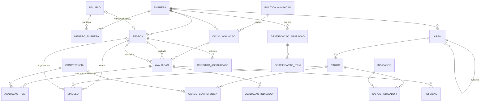

# Avaliação por competências · estrutura de dados para o site

R2 Tech Consultoria · versão 1 · 13/10/2026

Esta pasta transforma o modelo de avaliação (Word e Excel) em dados, para o site em que cada escritório cadastra funcionários e organograma, compartilha com a equipe e aplica as avaliações. Ela entrega só a estrutura: o site ainda não foi construído.

## O que está pronto

| Arquivo | Para que serve |
|---|---|
| `schema.sql` | Banco PostgreSQL (funciona no Supabase): 20 tabelas, tipos, regras de cálculo, organograma e segurança por linha. Carregado e testado no PostgreSQL 16. |
| `pacote.schema.json` | JSON Schema do formato de importação e exportação: uma chave por tabela, mesmos nomes de colunas. |
| `biblioteca-r2tech.json` | Dados padrão da R2 Tech para todos os clientes: 8 competências comportamentais, 40 técnicas em 8 áreas, 5 de liderança, faltas e atrasos e a política padrão. |
| `exemplo-surcin.json` | Primeiro cliente: organograma atual da Surcin, competências técnicas por cargo, indicadores, política proposta, 3 ciclos planejados e avaliações do piloto sem notas. |
| `../fonte/gerar_dados.py` e `../fonte/carregar_sql.py` | Geram os JSON a partir do modelo e os convertem em INSERTs para o banco. |

### Testes feitos

- Os dois JSON passam no JSON Schema, e um teste negativo (nota 7, tipo de vínculo inválido) é rejeitado.
- O `schema.sql` carrega sem erro, e os dois JSON entram no banco.
- Com os mesmos dados de teste da planilha, a view de notas dá o mesmo resultado: comportamentais 3,88, técnicas 4,00, indicadores 4,00, nota final 3,95, faixa "Atende".
- Segurança, com papéis simulados: a colaboradora vê o organograma inteiro, mas só a própria avaliação e a própria assiduidade, e não vê gratificação. A admin vê tudo. Quem não é membro não vê nada da empresa, só a biblioteca.

## Entidades e relações

| Grupo | Tabela | O que guarda | Pontos importantes |
|---|---|---|---|
| Acesso | `usuario` | Login (e-mail, nome) | No Supabase, vem do `auth.users`. |
| | `empresa` | Escritório cliente | Cada empresa só enxerga os próprios dados. |
| | `membro_empresa` | Papel do usuário na empresa | `admin`, `avaliador` ou `colaborador`. |
| Organograma | `area` | Setores | Pode ter subárea (`area_pai_id`). |
| | `cargo` | Cargos, missão e responsabilidades | Pertence a uma área. |
| | `pessoa` | Funcionário | Não precisa de login. Sem CPF, salário ou dado de saúde. |
| | `vinculo` | Quem ocupa qual cargo e quem é o gestor | Tem histórico. O organograma são os vínculos sem `data_fim` (view `v_organograma`). |
| Régua | `competencia` | Comportamentais, técnicas e liderança, com níveis 1, 3 e 5 | `empresa_id` nulo = biblioteca R2 Tech. A empresa pode criar as próprias. |
| | `cargo_competencia` | Técnicas de cada cargo (T1 a T6) | Permite ajustar o texto de "atender" ao processo do cliente. As comportamentais valem para todos. |
| | `indicador`, `cargo_indicador` | Faltas, atrasos e indicadores percentuais por cargo | Faltas e atrasos são padrão; os percentuais são por cargo. |
| | `politica_avaliacao` | Pesos, tabelas de conversão, faixas de gratificação | Em JSON (`[{"a_partir_de": 0, "nota": 5}]`). `validada_em` nulo = proposta ainda não aprovada. |
| Aplicação | `ciclo_avaliacao` | Período (piloto ou regular) | Status: planejado, aberto, em_avaliacao, fechado. |
| | `avaliacao` | Uma pessoa num ciclo | Guarda o cargo do momento. Status: nao_iniciada, autoavaliacao, avaliacao_gestor, conversa, fechada. |
| | `avaliacao_item` | Nota por competência: auto, gestor e final | A nota considerada é a final acordada; sem ela, vale a do gestor. |
| | `avaliacao_indicador` | Valor dos indicadores percentuais | Fração: 0,96 = 96%. |
| | `registro_assiduidade` | Faltas injustificadas, atrasos e faltas justificadas por mês | Só contagens. Nunca guardar atestado, CID ou motivo. |
| | `pdi_acao` | Plano de desenvolvimento | 2 ou 3 ações por avaliação. |
| Gratificação | `gratificacao_apuracao` | Ano, reserva mensal e fundo | `fundo` é calculado (reserva x meses). |
| | `gratificacao_item` | Valor de referência, nota do ano e valor por pessoa | Só a admin vê. |

## Regras de cálculo (iguais às da planilha)

1. A nota considerada de cada competência é a `nota_final`; se ela estiver vazia, vale a `nota_gestor`.
2. As médias de cada bloco (comportamentais e técnicas) são arredondadas em 2 casas.
3. Indicadores: faltas e atrasos somados no período do ciclo e convertidos pela tabela da política; os percentuais são convertidos pela `conversao_percentual`. O bloco é a média dessas notas.
4. A nota final é a média ponderada dos três blocos (40/40/20 no padrão) e só existe quando os três blocos têm nota.
5. A trilha de liderança é calculada à parte e não entra na nota.
6. A nota do ano é a média dos dois semestres. A faixa e o percentual vêm de `faixas_gratificacao`. A gratificação é o percentual vezes o valor de referência. Se a soma passar do fundo, todos os valores são reduzidos na mesma proporção.

Os passos 1 a 5 já estão na view `app.v_avaliacao_notas`. O passo 6 fica para o site, no fechamento do ano.

## Quem vê o quê

| | Admin (dono do escritório) | Avaliador | Colaborador |
|---|---|---|---|
| Organograma (áreas, cargos, pessoas, vínculos) | lê e altera | lê | lê |
| Competências, indicadores e política | lê e altera | lê | lê |
| Avaliações | todas | as que avalia | só a própria |
| Assiduidade | lê e altera | não vê | só lê a própria |
| Gratificação | lê e altera | não vê | não vê |

Isso está implementado com segurança por linha no banco. Uma regra fica para a API do site: o colaborador só pode gravar `nota_auto` e `evidencias`; as colunas do gestor e a nota final ficam para o avaliador e a admin.

## Fluxos que o site precisa ter

1. **Cadastro do escritório:** criar empresa, áreas, cargos e pessoas, montar o organograma (vínculos) e convidar a equipe por e-mail, com o papel de cada um.
2. **Montagem da régua:** para cada cargo, escolher de 4 a 6 competências técnicas na biblioteca (ou criar) e 2 indicadores; revisar a política.
3. **Ciclo:** abrir o ciclo, gerar as avaliações (uma por pessoa ativa, com as comportamentais, as técnicas do cargo e, se marcada, a trilha de liderança); a pessoa faz a autoavaliação, o gestor avalia, os dois conversam e fecham.
4. **Assiduidade:** lançar as contagens do mês.
5. **PDI e acompanhamento mensal.**
6. **Fechamento do ano:** calcular notas do ano e gratificação, limitadas ao fundo.

## Exemplo da Surcin: o que entrou e o que ficou de fora

Entrou o organograma atual do documento 02 (Thamires como gestora de Júlia, Vitória, Tamara e Alana), as competências técnicas e os indicadores do material de avaliação, a política proposta (não validada), os ciclos piloto 2026, 1º e 2º semestres de 2027, e as avaliações do piloto já abertas, sem notas.

Ficou vazio de propósito, porque as fontes não trazem esses dados: e-mails e logins, datas de admissão, tipo de vínculo de Júlia, Vitória e Tamara (`nao_informado`), notas, assiduidade, valores de referência e reserva mensal, e participação na gratificação (`a_definir` para todas).

## Decisões para o desenvolvimento

- **Plataforma:** o esquema segue PostgreSQL e funciona no Supabase (inclusive com Lovable). No Supabase, troque o corpo de `app.usuario_atual()` por `select auth.uid()` e ligue `usuario` ao `auth.users`.
- **Revisão trabalhista e LGPD:** antes de abrir para clientes, preparar o aviso de privacidade, definir quanto tempo guardar as avaliações e quem pode exportá-las.
- **Personalização por empresa:** a empresa pode copiar uma competência da biblioteca e editar; a original da R2 Tech não muda.
